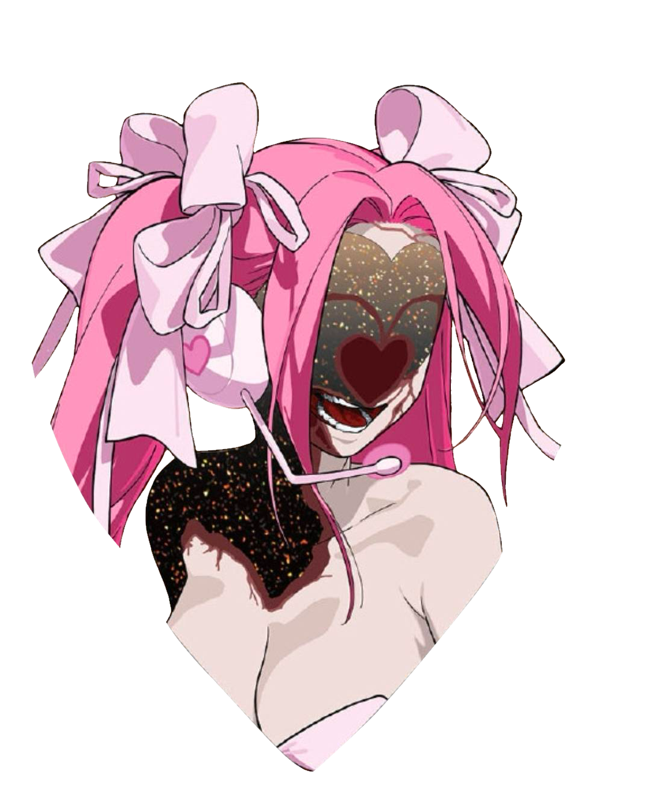

Oh to be desired... 
 
collective ⎯⎯                                      
Sylvester,  Syl(v)    they/he    19yo (2007)    🇷🇺 
monocon(? questioning) traumagen sys  .  tmascfem 
ASD & other symptoms, check status for energy/etc 
 
  ♡  

***

System's fictive and nonhuman heavy, leaning into monoconscious label. Some sourced from problematic medias like dandy's world and slopsaken, lowkey have no choice but to indulge into these two from time to time the worms in my brain are pestering for their next fix. Often refer as I/me aside from talking about all of the little worms because of mentioned monocon.  
Not making friends with those under 17 sorrie,. Don't be weird if you're a minor, it's common sense to not be suggestive with strangers.  
Idc about contradictory labels or nonhumanity or therians or toxic ships go off girl(genderneutral), I do care about pedophilic incestuous necrophiliac shit though I don't like you fans of that stuff. There is a reason this kind of stuff is illegal and no one's being "ableist" for not supporting your cookie run kingdom rape incest fanfic.
